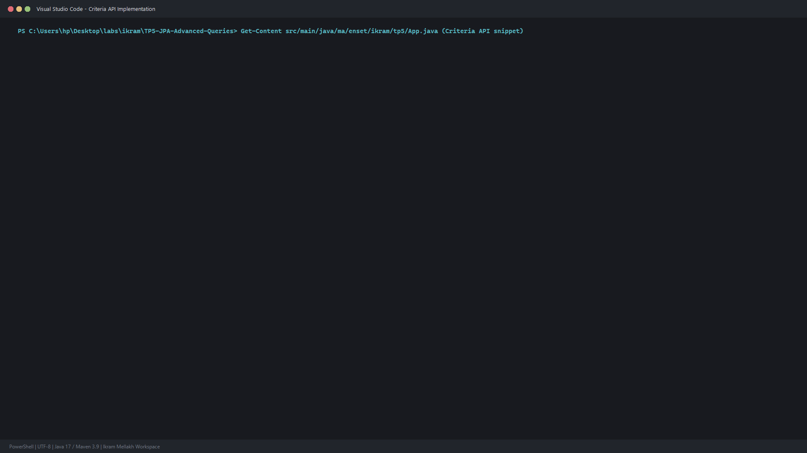
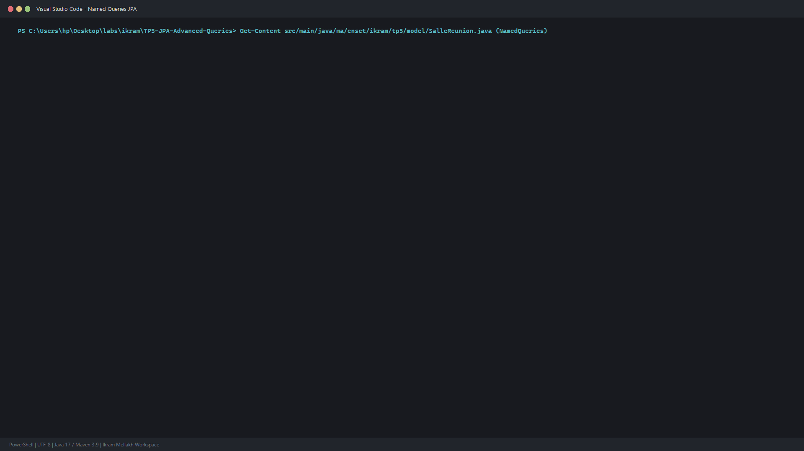
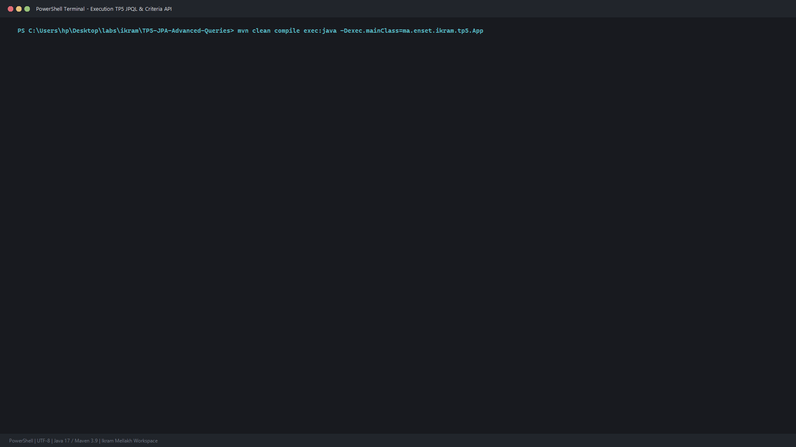

# TP 5 : Requêtes Avancées JPQL & Criteria API avec JPA

Mise en pratique approfondie des techniques d'interrogation et de requetage dynamique avec **JPA 2.2** et **Hibernate ORM 5.6** sur base **H2 Database**.

Realise par : **Ikram Mellakh**

---

## 1. Fonctionnalités et Requêtes Implémentées

1. **Requetes d'Agregation JPQL** : Calculs statistiques avec COUNT, AVG, et MAX.
2. **Jointures et Groupements (GROUP BY)** : Agregation du nombre de reservations et moyennes de participants par salle.
3. **Pagination JPA** : Exploitation de setFirstResult(offset) et setMaxResults(limit).
4. **Named Queries (@NamedQuery)** : Requetes precompilees definies au niveau de l'entite pour des performances optimales.
5. **Criteria API** : Construction dynamique et type-safe de requetes SQL a l'aide de CriteriaBuilder et Predicate.

---

## 2. Captures et Code

### Criteria API

### Named Queries

### Trace d'Execution Complète

---

## 3. Lancement

``bash
mvn clean compile
mvn exec:java "-Dexec.mainClass=ma.enset.ikram.tp5.App"
``