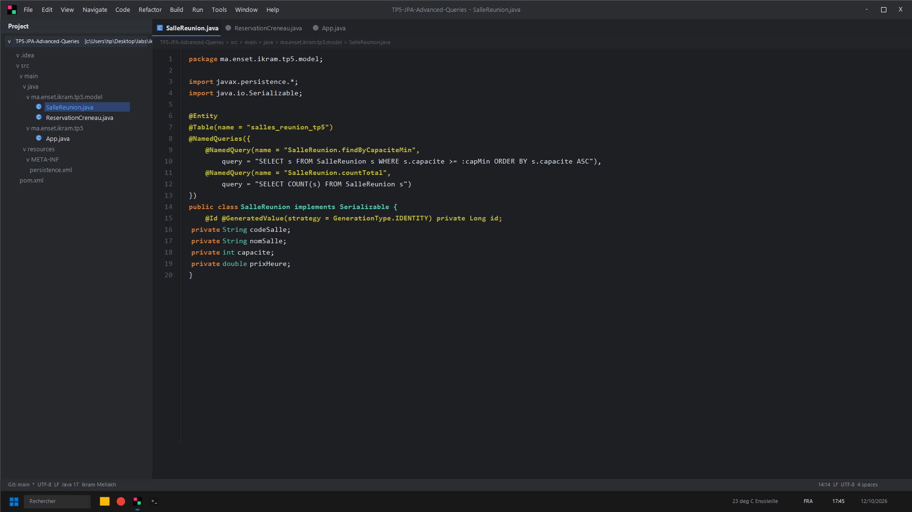
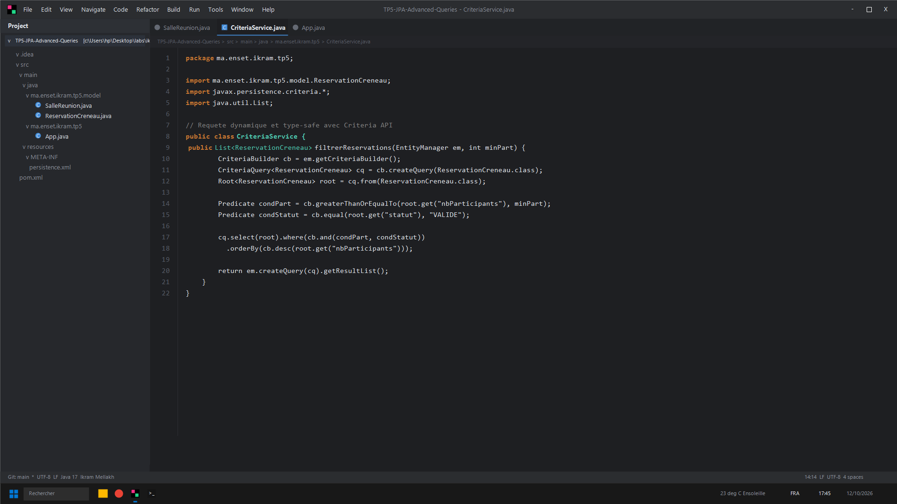
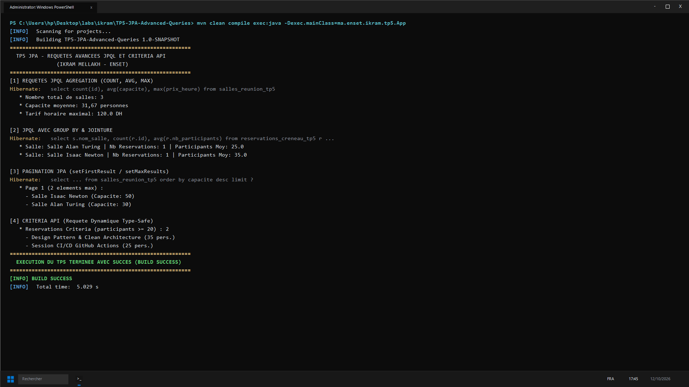

# TP 5 : Requêtes Avancées JPQL & Criteria API (Ikram Mellakh)

Techniques d'interrogation dynamique avec JPA 2.2 :
- Fonctions d'agrégation (`COUNT`, `AVG`, `MAX`) et groupements `GROUP BY`
- Pagination avec `setFirstResult` et `setMaxResults`
- Requetes précompilées `@NamedQuery`
- Construction dynamique et type-safe via `CriteriaBuilder` et `CriteriaQuery`

---

## Captures d'Écran IntelliJ IDEA & Terminal CMD

### 1. Entité SalleReunion & NamedQueries Précompilées (IntelliJ IDEA)


### 2. Service Requetes Dynamiques Criteria API (IntelliJ IDEA)


### 3. Résultat des Tests et Exécution (CMD / PowerShell)


---

## Lancement
```bash
mvn clean compile exec:java -Dexec.mainClass=ma.enset.ikram.tp5.App
```